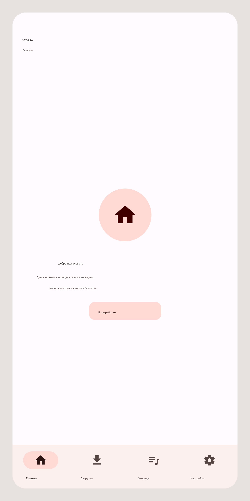
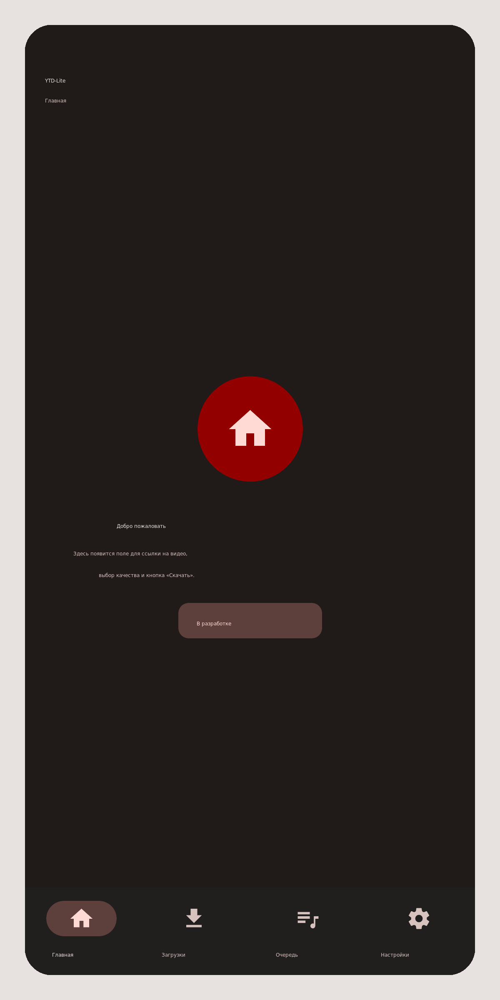

# YTD-Lite

Лёгкое Android-приложение **YTD-Lite** на Kotlin, полностью оформленное в
**Material Design 3** (Material You).

| Светлая тема | Тёмная тема |
| --- | --- |
|  |  |

*Превью текущих экранов (макеты, собранные по разметке проекта).*

Сейчас готов каркас: внизу — панель навигации из четырёх вкладок, каждая
открывает свой экран-заглушку.

| Кнопка внизу | Экран |
| --- | --- |
| **Главная** | стартовый экран (позже — поле для ссылки и выбор качества) |
| **Загрузки** | список скачанных файлов |
| **Очередь** | активные и ожидающие загрузки |
| **Настройки** | список категорий, каждая открывается отдельным экраном |

## Material Design 3 Expressive

Библиотека `com.google.android.material:material:1.14.0` (Material 3 Expressive),
`compileSdk 35`. Что из expressive используется:

- **Тулбар и нижняя навигация** — `Widget.Material3Expressive.Toolbar.OnSurface`
  и `Widget.Material3Expressive.BottomNavigationView` (крупнее индикатор,
  expressive-типографика подписей).
- **Кнопки** — `Widget.Material3Expressive.Button` (filled),
  `…Button.TonalButton`, `…Button.OutlinedButton`, `…Button.TextButton`
  (другая форма, размерные токены, «пружинистое» нажатие).
- **Сегментированный переключатель** движка на экране «Обновление» —
  `MaterialButtonToggleGroup` со стилем
  `Widget.Material3Expressive.MaterialButtonToggleGroup`
  (соединённые кнопки с общим внутренним радиусом).
- **Прогресс** — `Widget.Material3Expressive.CircularProgressIndicator` и
  `Widget.Material3Expressive.LinearProgressIndicator.Wavy` (волнистая полоса
  загрузки на «Главной»).
- **Нижний лист предпросмотра** — `BottomSheetDragHandleView` + expressive
  segmented button «Видео | Аудио», чипы `Widget.Material3.Chip.Filter`,
  обложка в карточке с радиусом 20dp, круглая кнопка
  `Widget.Material3Expressive.Button.IconButton.Filled` для «Поиска».
- **Списки «Очереди» и «Загрузок»** — `RecyclerView` с карточками 20dp на
  `SurfaceContainerLow`, тональной иконкой типа, `IconButton.Standard`
  в строке и волнистым `LinearProgressIndicator.Wavy` у активной задачи.
- **Motion** — подэкраны «Настроек» открываются и закрываются переходом
  `MaterialSharedAxis(Z)`; списки и ripple анимируются самой библиотекой.
- **Форма** — expressive-радиусы на уровне темы: `shapeCornerSizeSmall/Medium/
  Large/ExtraLarge` = 12/16/20/28dp (меню, диалоги, снекбары, чипы),
  карточки — 20dp, иконки пустых состояний — squircle 32dp.
- **Списки** — строки настроек 72dp, заголовок `TitleMedium`, подпись
  `BodyMedium`, иконки 24dp Material Symbols.

## Material Design 3

- **Полная цветовая схема ролей** (`primary`, `onPrimaryContainer`,
  `surfaceContainer*`, `outlineVariant`, `inverse*` и т.д.) для светлой и
  тёмной темы — см. `res/values/colors.xml` и `res/values-night/colors.xml`.
  Seed-цвет — фирменный красный `#B3261E`.
- **Dynamic Color (Material You)**: на Android 12+ палитра подстраивается под
  обои пользователя (`DynamicColors.applyToActivitiesIfAvailable` в `YtdLiteApp`).
  Не нужен — удалите одну строку в `YtdLiteApp.kt`.
- **M3-компоненты**: `MaterialToolbar` (small top app bar), `NavigationBar`
  (`BottomNavigationView` с active indicator), `MaterialCardView` (filled,
  тональный контейнер с иконкой), `Chip` (assist), системные типографические
  стили `TextAppearance.Material3.*`.
- **Тёмная тема** автоматически (`Theme.Material3.DayNight`).
- **Edge-to-edge**: контент уходит под системные панели, отступы учитываются
  через `fitsSystemWindows`.
- **Shape- и elevation-токены** — из стандартной темы Material 3.

## Иконки

Иконки действий — Material Symbols Outlined, 24dp: `ic_update` и `ic_refresh`
используют глиф **cached** (`viewBox 0 -960 960 960`, opsz 24, wght 400,
FILL 0, GRAD 0) — исходник
`google/material-design-icons/symbols/android/cached/materialsymbolsoutlined/cached_24px.xml`.
Цвет задаётся темой (`?attr/colorControlNormal` / `app:tint`), поэтому иконка
одинаково работает в светлой и тёмной теме.

## Папки сохранения

Экран **«Папки»** в «Настройках» задаёт, куда складывать готовые файлы —
отдельно для **видео** и для **аудио**:

- папка выбирается системным диалогом (`ACTION_OPEN_DOCUMENT_TREE`), доступ
  выдаётся через `takePersistableUriPermission` и сохраняется между запусками —
  разрешения на хранилище (`READ/WRITE_EXTERNAL_STORAGE`) не нужны;
- по умолчанию используется папка приложения: `Movies` для видео и `Music`
  для аудио (`Context.getExternalFilesDir`), кнопка «Сбросить к папке по
  умолчанию» возвращает её и отпускает доступ к выбранной папке;
- если доступ к выбранной папке пропал (её удалили), строка так и пишет —
  «Доступ потерян», папку нужно выбрать заново;
- код: `data/settings/FolderPreferences.kt` (хранение + `DownloadTarget`,
  через который будущий загрузчик получит `Tree(uri)` или `Local(dir)`) и
  `ui/settings/FoldersFragment.kt`.

## Первый запуск

При старте приложения (не при повороте экрана) показывается приветственное окно
Material 3 Expressive: «Первая сборка — YTD-Lite 0.1.0-alpha» и текст о том, что
это alpha и как работает загрузка. Внутри — галочка **«Больше не показывать»**
и кнопка **«Ок»** (`ui/onboarding/FirstRunDialog.kt`, разметка
`res/layout/dialog_first_run.xml`).

- Галочка оформлена как тональная строка (`MaterialCheckBox` +
  `bg_check_row.xml`, радиус 16dp, 56dp высоты) — видно, что она активна.
- Галочка сохраняется в `FirstRunPreferences` (SharedPreferences
  `ytdlite-settings`, ключ `first_run_dialog_dismissed`).
- Если закрыть окно, не отметив галочку, оно появится снова при следующем запуске.
- Тексты переведены на все 5 языков.

## Главная: ссылка и предпросмотр

1. Вставьте ссылку в поле «Ссылка на видео или аудио» — круглая
   expressive-кнопка **«Поиск»** видна всегда: пока поле пустое, она приглушена
   (45 % прозрачности, 90 % масштаба) и не нажимается, а с появлением текста
   становится яркой и активной.
2. Открывается нижний лист с обложкой 16:9, названием и подписью
   «автор · длительность». Пока yt-dlp разбирает ссылку, в листе видна строка
   «Получаем информацию…», при ошибке — её текст.
3. Переключатель **«Видео | Аудио»** (`MaterialButtonToggleGroup`,
   expressive-стиль) и чипы качества:
   - видео — «Лучшее» и доступные разрешения (1080p, 720p, 480p, …);
   - аудио — «Лучшее», 192 / 128 / 64 kbps.
   Если ссылка ведёт только на аудио (например, трек), кнопка «Видео» серая и
   недоступна, под переключателем появляется подпись «В этой ссылке только
   аудио».
4. **«Скачать»** — кнопка и переключатели блокируются, идёт загрузка с
   определённым прогрессом (волнистая полоса + проценты), затем строка
   «Готово: <имя файла>». Файл попадает в папку из «Настройки → Папки»:
   - выбрана папка через SAF — yt-dlp качает во временную папку приложения, а
     готовый файл копируется документом (`DocumentsContract.createDocument`),
     поэтому работает и карта памяти, и облачный провайдер;
   - папка не выбрана — `Android/data/com.ytdlite.app/files/Movies|Music`.

Селекторы формата:

| Выбор | С ffmpeg | Без ffmpeg (по умолчанию) |
| --- | --- | --- |
| Видео, «Лучшее» | `bv*+ba/b` | `b[ext=mp4]/b` |
| Видео, Np | `bv*[height<=N]+ba/b[height<=N]` | `b[height<=N]/b` |
| Аудио, «Лучшее» | `-x --audio-format m4a -f ba` | `-f ba` |
| Аудио, K kbps | `-x --audio-format m4a -f ba[abr<=K]/ba` | `-f ba[abr<=K]/ba` |

Обложка грузится вручную (`HttpURLConnection` + `BitmapFactory` в
`Dispatchers.IO`) — без Coil, чтобы не раздувать APK.

## Очередь

- Все загрузки идут через общую `DownloadQueue` (`data/queue/`): загрузка
  продолжается, даже если закрыть лист предпросмотра или уйти на другую
  вкладку (очередь живёт в `YtdLiteApp`).
- Задачи качаются **по одной** — движок yt-dlp тяжёлый, параллельные
  Python-процессы телефону не нравятся. Состояния: `PENDING` → `RUNNING` →
  `DONE` / `FAILED` / `CANCELED`.
- Вкладка «Очередь» подписана на `StateFlow<List<DownloadTask>>` и показывает
  название, «Видео/Аудио · 1080p», живой статус с процентами и волнистый
  прогресс. Кнопка справа:
  - **«Отменить»** — ожидающую задачу убирает из списка, активную
    останавливает через `YtDlpEngine.cancel(processId)`;
  - **«Повторить»** — перезапускает упавшую задачу;
  - **«Убрать»** — убирает завершённую из списка.
- Пустое состояние — карточка 96dp с иконкой и «Очередь пуста».

## Загрузки

- История файлов — `data/download/DownloadHistory.kt`
  (SharedPreferences + JSON, без Room): имя, тип, размер, дата, путь или URI.
- После успешной загрузки файл попадает сюда автоматически; список
  перечитывается при каждом возврате на вкладку.
- Нажатие открывает файл во внешнем плеере: для папки приложения — через
  `FileProvider` (authority `${applicationId}.fileprovider`,
  `res/xml/file_paths.xml`), для папки SAF — по URI документа.
- Корзина удаляет и запись, и сам файл (`DocumentsContract.deleteDocument`
  для SAF, `File.delete()` для папки приложения) после подтверждения в
  expressive-диалоге.
- Размер форматирует системный `Formatter.formatShortFileSize`, дату —
  `DateFormat`, поэтому переводить эти подписи не нужно.

## Языки

Приложение переведено на 5 языков, переключение — экран **«Язык»** в
«Настройках» (или системные «Языки приложения» на Android 13+):

| Язык | Ресурсы |
| --- | --- |
| Беларуская | `values-be` |
| Moldovenească (молдавский / румынский) | `values-ro` |
| Русский | `values-ru` |
| Українська | `values-uk` |
| English (по умолчанию) | `values` |

- Выбор сохраняется через per-app language API AppCompat
  (`AppCompatDelegate.setApplicationLocales`), приложение сразу перезапускается
  на выбранном языке; пункт «Как в системе» возвращает язык устройства.
- Список языков для системных настроек — `res/xml/locales_config.xml`
  (`android:localeConfig` в манифесте).
- `values` — английский как язык по умолчанию, остальные локали полные
  (одинаковый набор из 104 строк, форматные аргументы совпадают).

## Экраны «Настройки»

Вкладка «Настройки» — сгруппированный список в стиле Material 3 Expressive:
заголовок раздела (`TitleSmall`, `onSurfaceVariant`) + карточка с радиусом 20dp,
внутри строки `SettingsRowView` (тональный контейнер иконки 40dp, заголовок
`TitleMedium`, подпись `BodyMedium`, «шеврон»), разделённые тонкой линией
с отступом 72dp. Нажатие открывает отдельный экран поверх вкладки, назад —
стрелка в тулбаре (`MainActivity.openSubScreen`).

**Основное**

| Категория | Подпись в списке | Экран |
| --- | --- | --- |
| Папки | «Аудио папка, видео папка» | `FoldersFragment` |
| Язык | текущий язык (например «Русский») | `LanguageFragment` |

**Приложение**

| Категория | Подпись в списке | Экран |
| --- | --- | --- |
| Обновление | «Обновления приложения и yt-dlp» | `UpdateFragment` |
| О приложении | «Версия, движок, ссылки» | `AboutFragment` |

Все четыре экрана реализуют `TitledFragment` — их название автоматически
попадает в тулбар вместе с кнопкой «назад».

**О приложении**

- иконка, название, версия (`versionName` = `v0.1.0-alpha`, `versionCode` = 1);
- кнопка **«История изменений»** открывает отдельный экран (`ChangelogFragment`):
  плитки выпусков (версия `v0.1.0-alpha`, дата `2.11.2026`, чип «Текущая»),
  нажатие на плитку открывает подробности (`ChangelogDetailsFragment`) —
  версия, дата и одна строка описания «Первый альфа-выпуск YTD-Lite»
  (списка пунктов нет); в тулбаре заголовок = номер версии.
- данные истории — `data/update/Changelog.kt` (версия, дата и `summary`),
  поэтому переводится на все 5 языков; новый выпуск добавляется первым
  элементом.
- ссылки на yt-dlp и исходники с экрана убраны.

**Обновление**

- На экране одна категория — *yt-dlp*: заголовок раздела и строка
  **«Обновление и скачать yt-dlp»**. Проверки обновлений приложения на этом
  экране нет (удалена вместе с заголовком «Программа» и строкой версии).
- Строка **«Обновление и скачать yt-dlp»** (в том же стиле, что и
  список «Настроек»: иконка `cached` в тональном контейнере, подпись с текущим
  движком, «шеврон») открывает отдельный экран `YtDlpFragment` — вложенный
  подэкран «Настройки» → «Обновление» → «yt-dlp».
- На экране yt-dlp — выбор сборки и одна кнопка **«Проверить сейчас»**:
  - **Встроенная сборка** (по умолчанию) — та, что лежит в APK; проверка
    сравнивает её с последним стабильным релизом
    [yt-dlp/yt-dlp](https://github.com/yt-dlp/yt-dlp).
  - **Ночная сборка** — проверка сравнивает с последним релизом
    [yt-dlp-nightly-builds](https://github.com/yt-dlp/yt-dlp-nightly-builds).
  - Проверка ничего не скачивает: запрос к GitHub API
    (`YtDlpUpdateChecker`), сравнение версий. Если версия новее — открывается
    диалог Material 3 Expressive «Доступно обновление» с кнопками **Да / Нет**.
    Только после «Да» сборка скачивается и устанавливается
    (`YtDlpEngine.update(channel)`), в подписи появляется «yt-dlp обновлён: …».
  - Если новее ничего нет — «Обновлений нет: установлена последняя версия …».
  - **«Вернуть встроенную версию»** (текстовая кнопка, видна когда стоит
    скачанная сборка) удаляет скачанный движок и распаковывает бинарник из APK.

Состояние хранится в `YtDlpPreferences` (SharedPreferences): `BUNDLED` — версия из APK,
`STABLE` — скачанный стабильный релиз, `NIGHTLY` — ночная сборка.

## Движок загрузки yt-dlp

В коде уже подключён сам загрузчик — **[yt-dlp](https://github.com/yt-dlp/yt-dlp)**
через библиотеку `youtubedl-android` (несёт внутри Python и ffmpeg, отдельный
бинарник на Android не нужен). В интерфейсе он пока не используется — добавлен
только слой `data/ytdlp`.

```
app/src/main/java/com/ytdlite/app/data/ytdlp/
├── YtDlpEngine.kt          # init, version, update, videoInfo, download, cancel
├── YtDlpDownloadRequest.kt # url, папка, селектор формата, доп. опции
├── YtDlpVideoInfo.kt       # метаданные видео + список форматов
├── YtDlpProgress.kt        # проценты, ETA, строка вывода
├── YtDlpResult.kt          # результат загрузки / обновления
├── YtDlpUpdateChannel.kt   # STABLE и NIGHTLY
└── YtDlpException.kt
```

Что умеет `YtDlpEngine`:

| Метод | Назначение |
| --- | --- |
| `prepare()` | распаковать Python/yt-dlp/ffmpeg (один раз, потокобезопасно) |
| `version()` / `versionTag()` | версия установленного yt-dlp |
| `update(channel)` | обновить yt-dlp: `STABLE` — релизы [yt-dlp/yt-dlp](https://github.com/yt-dlp/yt-dlp), `NIGHTLY` — [yt-dlp-nightly-builds](https://github.com/yt-dlp/yt-dlp-nightly-builds) |
| `videoInfo(url)` | название, автор, длительность, форматы |
| `download(request, processId, onProgress)` | скачивание видео или аудио с прогрессом |
| `cancel(processId)` | остановить загрузку |
| `defaultDownloadDirectory()` | папка приложения `.../files/Download` (без разрешений) |

Пример вызова (из будущего экрана «Главная»):

```kotlin
val engine = YtDlpEngine.get(context)
val info = engine.videoInfo(url)
engine.download(
    YtDlpDownloadRequest(url = url, outputDirectory = engine.defaultDownloadDirectory()),
    processId = info.id,
    onProgress = { progress -> /* прогресс для «Очереди» */ }
)
// yt-dlp можно обновить в любой момент:
engine.update(YtDlpUpdateChannel.NIGHTLY)
```

Собирается **один APK** только под 64-битный ARM (Android 8+):
`app-arm64-v8a-release.apk`.

Размер — **~24 МБ**, из них:

| Что внутри | Вес |
| --- | --- |
| `libpython.zip.so` — Python-рантайм для yt-dlp | ~13 МБ |
| `res/raw/ytdlp` — сам yt-dlp | ~3 МБ |
| код (dex) | ~3 МБ |
| остальное (ресурсы, иконки, манифест) | <1 МБ |

ffmpeg в сборку по умолчанию **не входит** (это ещё ~33 МБ): он нужен только
для склейки раздельных видео- и аудиодорожек (качество выше 720p) и для
извлечения аудио. Без него yt-dlp качает готовые прогрессивные файлы до 720p.

Нужна склейка дорожек / аудио в m4a — соберите с ffmpeg:

```bash
./gradlew assembleRelease -PwithFfmpeg=true
# APK ~57 МБ, движок сам инициализирует ffmpeg (BuildConfig.HAS_FFMPEG)
```

## Что уже работает

- Приложение запускается; сверху только название **YTD-Lite** — «YTD» фирменным
  голубым (`md_brand_blue`), подписи вкладки нет (её и так видно в нижней
  навигации), у подэкранов в тулбаре появляется название и кнопка «назад».
- Нижняя навигация переключает 4 экрана; выбранная вкладка сохраняется при
  повороте экрана.
- Кнопка «Назад» из любой вкладки возвращает на «Главную», со «Главной» — выход.
- Светлая и тёмная тема.
- «Главная»: поле ссылки → появляется «Поиск» → нижний лист с обложкой,
  названием, выбором «Видео / Аудио», качеством и кнопкой «Скачать». Файл
  сохраняется в папку из настроек (SAF) или в папку приложения.
- «Очередь»: живые задачи с прогрессом, отмена, повтор, удаление из списка.
- «Загрузки»: история файлов с размером и датой, открытие во внешнем плеере,
  удаление с подтверждением.
- Иконка приложения: полный adaptive-icon набор (все плотности,
  foreground/background/monochrome — включая тематические иконки Android 13+).

## Структура проекта

```
app/src/main/
├── java/com/ytdlite/app/
│   ├── YtdLiteApp.kt               # Application: включает Dynamic Color
│   ├── data/download/DownloadSaver.kt    # копирование файла в папку SAF
│   ├── data/download/DownloadHistory.kt  # история файлов (SharedPreferences + JSON)
│   ├── data/queue/DownloadQueue.kt       # очередь: по одной задаче, StateFlow
│   ├── data/queue/DownloadTask.kt        # задача и её состояния
│   ├── MainActivity.kt             # тулбар + навигация по вкладкам
│   └── ui/
│       ├── home/HomeFragment.kt    # поле ссылки + кнопка «Поиск»
│       ├── home/VideoSheetFragment.kt  # нижний лист: обложка, качество, «Скачать»
│       ├── queue/QueueFragment.kt + QueueAdapter.kt      # активные задачи
│       ├── downloads/DownloadsFragment.kt + DownloadsAdapter.kt  # история файлов
│       ├── downloads/DownloadsFragment.kt
│       ├── queue/QueueFragment.kt
│       └── settings/SettingsFragment.kt
└── res/
    ├── layout/activity_main.xml    # top app bar + контент + navigation bar
    ├── layout/fragment_*.xml       # экраны (M3 empty state)
    ├── layout/sheet_video.xml      # нижний лист предпросмотра
    ├── layout/view_quality_chip.xml# чип качества в листе
    ├── layout/view_queue_item.xml  # строка «Очереди»
    ├── layout/view_download_item.xml # строка «Загрузок»
    ├── menu/bottom_nav_menu.xml    # четыре кнопки внизу
    ├── drawable/ic_*.xml           # иконки (Material Symbols Outlined, 24dp)
    ├── mipmap-*/                   # иконка приложения (mdpi…xxxhdpi)
    ├── mipmap-anydpi-v26/          # adaptive icon
    ├── values/colors.xml           # палитра M3 (light)
    ├── values-night/colors.xml     # палитра M3 (dark)
    ├── values/themes.xml           # тема Theme.Material3.DayNight
    ├── values/strings.xml          # тексты (en, по умолчанию)
    ├── values-ru/, values-uk/,
    │   values-be/, values-ro/      # переводы
    └── xml/locales_config.xml      # список языков для системы
```

## Оптимизация размера APK

Из чего состоит release-APK и что вообще можно уменьшить:

| Часть | Было | Стало | Можно ли уменьшить |
| --- | --- | --- | --- |
| `lib/arm64-v8a/libpython.zip.so` | ~13,4 МБ | 13 723 КБ | нет — это Python и сам yt-dlp |
| `res/raw/ytdlp` (встроенный yt-dlp) | ~3,0 МБ | 3 096 КБ | нет — движок по умолчанию работает офлайн |
| `classes*.dex` | ~4,4 МБ (2 dex) | 1 379 КБ (1 dex) | был — R8 |
| `resources.arsc` | ~1,0 МБ | 637 КБ | был — только 5 локалей |
| прочие `res/*` | ~0,6 МБ | ~0,3 МБ | был — `shrinkResources` |
| `libqjs` + прочее | ~0,4 МБ | 433 КБ | нет — quickjs нужен yt-dlp |
| **APK целиком** | **≈25,2 МБ** (`du` 24M) | **20 150 602 байт (19,2 МиБ)** | **−5 МБ, −20 %** |

Внутри итоговых 20,15 МБ по категориям: нативные 14 149 КБ, `res/` 3 399 КБ,
`dex` 1 379 КБ, `resources.arsc` 637 КБ, всё прочее — 9 КБ. То есть ~17 МБ из
20 — это сам движок (Python + yt-dlp + quickjs), его без потери функций
не уменьшить.

## Оптимизация сборки

- `gradle.properties`: `-Xmx3g` под R8, параллельная сборка,
  `org.gradle.caching=true`, `kotlin.incremental=true`, отдельный heap для
  Kotlin-демона.
- CI (`.github/workflows/build-apk.yml`):
  - `gradle/actions/setup-gradle@v4` — кэш `~/.gradle` и build cache между
    запусками: зависимости не скачиваются заново, задачи `compile*`,
    `dexBuilder`, R8 и `aapt2` переиспользуются;
  - `--build-cache` вместо `--no-daemon` — Gradle-демон живёт всю сборку;
  - `concurrency` с `cancel-in-progress` — новый пуш отменяет прошлый прогон;
  - `lint { checkReleaseBuilds = false }` — lint не тормозит сборку APK.
- В логе сборки печатается разбор APK: точный размер в байтах, сумма по
  категориям (dex / нативные / res / arsc / прочее) и топ-5 файлов — видно
  эффект каждой правки. На повторных прогонах с тёплым кэшем сборка занимает
  ~1,5 минуты вместо ~5.
- Локально: `./gradlew assembleRelease --build-cache` (то же, что в CI).
  Замер размера: `unzip -v app/build/outputs/apk/release/*.apk | sort -k3 -nr | head`.

## Как собрать

### Вариант 1. Android Studio

1. Открыть папку проекта в Android Studio (Ladybug или новее).
2. Дождаться Gradle Sync (студия скачает Gradle 8.9 и Android SDK 34).
3. `Run ▶` на 64-битном ARM-устройстве с Android 8.0+ (эмулятор x86 в этой
   сборке не поддерживается — выбран только `arm64-v8a`).

### Вариант 2. Командная строка

```bash
./gradlew assembleRelease
# APK: app/build/outputs/apk/release/app-arm64-v8a-release.apk  (~24 МБ)
```

Debug-вариант (`./gradlew assembleDebug`) остаётся только для запуска из
Android Studio — релизные сборки делаются через `assembleRelease`.

Нужны JDK 17 и Android SDK (platform 34); путь к SDK — в `local.properties`
(`sdk.dir=/path/to/Android/Sdk`).

### Вариант 3. Готовый APK из GitHub Actions

Workflow `.github/workflows/build-apk.yml` собирает **только release-APK** при
каждом пуше: **Actions → Build APK → нужный запуск → Artifacts → ytd-lite-release**.

## Подпись APK (важно при установке)

Все сборки — и локальные, и из GitHub Actions — подписаны **одним постоянным
ключом** из репозитория (`keystore/ytdlite-keystore.p12`), поэтому новый APK
ставится поверх старого без ошибки
«Приложение не установлено, так как оно конфликтует с другим пакетом».

Если такая ошибка всё же появилась (например, раньше ставилась сборка,
подписанная другим ключом), один раз удалите приложение и установите APK заново —
дальше обновления будут проходить без удаления.

Реквизиты ключа по умолчанию:

| Параметр | Значение |
| --- | --- |
| Файл | `keystore/ytdlite-keystore.p12` |
| Тип | `PKCS12` |
| Пароль хранилища/ключа | `ytdlite2026` |
| Alias | `ytdlite` |

> Ключ лежит в открытом репозитории: он подходит для личной установки и тестов,
> но не для публикации в Google Play (там нужен приватный ключ).

### Свой ключ

1. Создайте ключ:
   ```bash
   keytool -genkeypair -v -keystore keystore/my-release.jks -alias mykey \
     -keyalg RSA -keysize 2048 -validity 10000
   ```
2. Создайте в корне `keystore.properties` (он в `.gitignore`):
   ```properties
   storeFile=keystore/my-release.jks
   storeType=JKS
   storePassword=ваш_пароль
   keyAlias=mykey
   keyPassword=ваш_пароль
   ```
3. Пересоберите APK. В CI свои секреты можно передать через GitHub Secrets,
   записав такой же файл шагом перед сборкой.

> Пароли в `build.gradle.kts` — только значения по умолчанию для ключа из
> репозитория; собственные лучше хранить в `keystore.properties` или Secrets.

## Что попадает в git, а что нет

В репозитории лежит только исходный код. `.gitignore` закрывает всё, что
собирается локально, зависит от конкретной машины или является секретом:

| Группа | Что игнорируется |
| --- | --- |
| Сборка | `build/`, `app/build/`, `/out/`, `/captures`, `*.apk`, `*.aab`, `*.apks`, `*.ap_`, `*.dex`, `*.class`, `*.hprof`, `*.log`, `lint-results*.xml` |
| Gradle / Kotlin / NDK | `.gradle/`, `.kotlin/`, `local.properties`, `.externalNativeBuild/`, `.cxx/` |
| IDE | `.idea/`, `*.iml`, `*.ipr`, `*.iws`, `.vscode/`, `.navigation/`, `.project`, `.settings/`, `.classpath` |
| **Ключи и секреты** | `keystore/`, `*.jks`, `*.keystore`, `*.p12`, `*.pfx`, `*.pepk`, `*.pk8`, `*.pem`, `*.der`, `keystore.properties`, `signing.properties`, `key.properties`, `secrets.properties`, `.env*`, `token.txt`, `*.token`, `.npmrc`, `.pypirc` |
| Системный мусор | `.DS_Store`, `._*`, `Thumbs.db`, `desktop.ini`, `*.swp` |

Перед коммитом полезно проверить, что ничего лишнего не попало:

```bash
git status --short
git ls-files | grep -Ei 'keystore|secret|token|\.apk$|\.jks$'
```

> **Важно про ключ подписи.** `keystore/ytdlite-keystore.p12` сейчас лежит
> в репозитории намеренно: именно им подписываются и локальные сборки, и APK
> из GitHub Actions, поэтому обновления ставятся поверх старых. Это
> единственный «секрет» в репозитории. Чтобы убрать его из публичного доступа:
> положить файл в GitHub Secrets (`Settings → Secrets and variables → Actions`,
> например `KEYSTORE_P12_BASE64`), добавить шаг распаковки в workflow и
> удалить файл из истории (`git filter-repo`). После такой чистки старые APK
> и новые будут подписаны одним ключом только при условии, что ключ сохранён
> у вас локально.

## Технические параметры

- `applicationId`: `com.ytdlite.app` (один и тот же для debug и release)
- Абсолютный путь сборки: только `arm64-v8a`, один APK
- Версия: `versionCode 1`, `versionName v0.1.0-alpha`
- minSdk 26 (Android 8.0), targetSdk 34, compileSdk 35
- Kotlin 2.0.21, AGP 8.6.1, Gradle 8.9, ViewBinding
- Material Components 1.14.0 (M3 Expressive), AndroidX Activity 1.9.2, Fragment 1.8.3
- Экраны — отдельные фрагменты, каждый развивается независимо.

## Что дальше

Уведомление о завершении загрузки и открытие файла из него, сохранение
очереди между запусками, настройки формата по умолчанию. Разбор ссылки,
очередь и история файлов уже работают.
