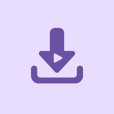

  

<h1 align="center">YTD-Lite</h1>

  Компактная Android-программа на базе <code>yt-dlp</code> для скачивания видео и аудио из разных сервисов.

  
  
  
   
  
  
  

## Системные требования

| Параметр | Требование |
| --- | --- |
| **Android** | 8.0 (API 26) или новее. |
| **Процессор** | 64-битный ARM, `arm64-v8a`. |
| **Оперативная память** | ~150 МБ |

## Планы

- [ ] Уведомления о завершении загрузки.

- [ ] Настройки формата и качества по умолчанию.

- [ ] Переход из альфа-версии в бета-версию.

- [ ] Выбор движка загрузки.

- [ ] Встроенный плеер.

- [ ] Загрузка аудио и видео с сохранением метаданных.

- [ ] Режим высокой контрастности.

- [ ] Удаление аудиодорожки из видео.

- [ ] Перекодирование видео.

- [ ] Автоматическое обновление приложения и движка `yt-dlp`.
